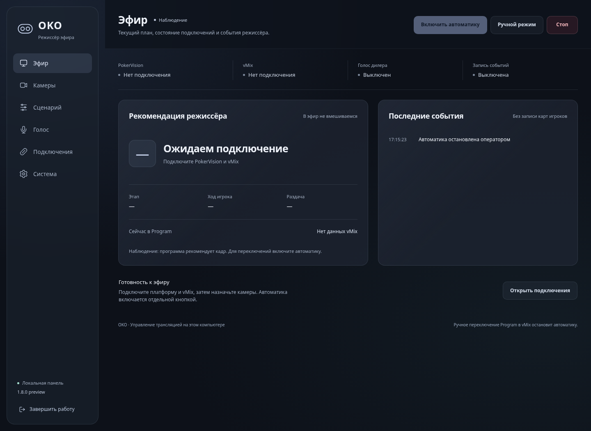

# OKO — автоматический режиссёр PokerVision → vMix

## Скачать

**[Скачать полный комплект OKO 1.8.8 preview с Vosk](https://github.com/resokol/OKO/releases/download/v1.8.8-preview/OKO-1.8.8-Vosk-offline.zip)** · [Страница выпуска](https://github.com/resokol/OKO/releases/tag/v1.8.8-preview)

Автономная программа для Windows 10/11 x64. Дополнительно устанавливать .NET или Node.js не требуется. Панель управления открывается в браузере на том же компьютере.

В 1.8.8 добавлены автоматический сплит vMix по камерам игроков, Merge на крупный план стола и встроенное обновление в разделе «Система».

## Подключение через API PokerVision

В «Подключениях» введите ключ чтения, загрузите список и нажмите «Подключить стол». OKO сохранит подключение в профиле Windows. На вкладке «Эфир» под этапом игры видна история раздачи. Запись ходов, общих карт и результатов в файл включается в «Системе». Подробности о голосе и смене ключей есть в инструкции в архиве.

## Голосовое исправление «Ошибка» — 1.8.4 preview

**[Скачать OKO 1.8.4 для Windows](https://github.com/resokol/OKO/raw/refs/heads/main/downloads/OKO-1.8.4-preview.exe)** · [Комплект с Vosk](https://github.com/resokol/OKO/raw/refs/heads/main/downloads/OKO-1.8.4-Vosk-offline.7z) · **[Памятка дилера — PDF](docs/OKO-Dealer-Guide-RU.pdf)**

«Ошибка, бокс два, рейз до пяти тысяч» исправляет последнее принятое действие этого бокса в текущем круге, включая более раннее относительно остальных игроков. «Первое действие» / «действие один» выбирает конкретное действие бокса. «Правильно бокс три чек» позволяет изменить ошибочный номер места. После отдельного «Ошибка» можно сделать паузу, затем произнести полную команду.

Последующие явно названные места сохраняются; команды без номера пересчитываются по исправленной очереди. Противоречивое исправление отклоняется целиком. Это изменение распознанных действий и очереди; отправка в PokerVision по-прежнему требует управляющего API. [Подробности](docs/dealer-speech.md).

320 проверок приложения прошли; проверены нативный Vosk и браузер. Памятка для дилера содержит только команды, переход хода и исправления — без настроек и описания программы. Windows/vMix здесь не запускались. [Проверки](docs/verification-1.8.4-error.md).

Перед заменой EXE завершите старый OKO через «Завершить работу». Папку speech-assets сохраните: модель прежняя.

## Раскрывающийся блок олл-ина — 1.8.3 preview

**[Скачать OKO 1.8.3 для Windows](https://github.com/resokol/OKO/raw/refs/heads/main/downloads/OKO-1.8.3-preview.exe)** · [Комплект с готовым Vosk](https://github.com/resokol/OKO/raw/refs/heads/main/downloads/OKO-1.8.3-Vosk-offline.7z)

В «Сценарии» настройки **«Олл-ин или дуэль»** вынесены в отдельный свёрнутый блок рядом с эмоциями, долгим ходом и проходом по игрокам. Направление прохода перенесено в «Проход по игрокам». Проверены раскрытие с клавиатуры, сохранение скрытых настроек и экран 320/768/1440. Логика режиссёра и голоса прежняя. [Инструкция](docs/workspace-1.8.md) · [Проверка](docs/verification-1.8.3-disclosure.md).

Перед заменой EXE завершите старый OKO через «Завершить работу». Сохраняйте папку speech-assets: повторно скачивать модель не нужно.

## Слежение за столом — 1.8.2 preview

**[Скачать OKO 1.8.2 с готовым Vosk](https://github.com/resokol/OKO/raw/refs/heads/main/downloads/OKO-1.8.2-Vosk-offline.7z)** · [Обычная EXE](https://github.com/resokol/OKO/raw/refs/heads/main/downloads/OKO-1.8.2-preview.exe) · [Инструкция](docs/dealer-speech.md)

В разделе **«Голос»** добавлена отдельная кнопка **«Слежение за столом»**. При включении она берёт текущего игрока из PokerVision: если ход второго, первое «чек» без номера относится ко второму. Дальше можно говорить «поднял на сто», «фолд», «чек» — очередь движется по активным местам. Явный номер заново задаёт точку отсчёта. Например, «первый бокс чек, второй поднял на сто, третий сбросил, чек» → места 1, 2, 3, 4. Фолды/олл-ины пропускаются, этапы берутся с платформы. При ошибке назовите бокс ещё раз. Отправка действий в PokerVision и управление камерами этой кнопкой не добавлены.

298 проверок приложения прошли. Реальное аудио «чек» через нативный Vosk последовательно назначилось игрокам 2 и 3; проверены кнопка, навигация, начальная синхронизация и остановка при потере аудио. На Windows/vMix и голосе реального дилера здесь не проверялось. [Результаты](docs/verification-1.8.2-tracking.md).

Модель прежняя: при замене только EXE сохраняйте папку `speech-assets`. Сначала завершите старую OKO через «Завершить работу», затем запустите новую EXE. В панели должна быть версия 1.8.2 preview. Слежение изначально выключено; включите микрофон и отдельную кнопку слежения, когда готовы.

## Расширенный словарь — 1.8.1 preview

**[Скачать OKO 1.8.1 с готовым Vosk](https://github.com/resokol/OKO/raw/refs/heads/main/downloads/OKO-1.8.1-Vosk-offline.7z)** · [Обычная EXE](https://github.com/resokol/OKO/raw/refs/heads/main/downloads/OKO-1.8.1-preview.exe) · [Голосовые команды](docs/dealer-speech.md)

Теперь можно говорить «первый чек», «второй чек», «третий бокс чек», «четвёртый чек», «пятый сбросил», «шестой поднял на триста». Порядковые номера от первого до десятого; «бокс»/«место» можно ставить до или после номера либо опустить перед порядковым номером. Старые команды «бокс один чек» сохранены. Добавлены «сбросил», «скинул», «уравнял», «поднял», «повысил», «поставил». Для рейза обязательно различаются «до» и «на».

Модель та же: при обновлении только EXE сохраните существующую папку speech-assets. Сначала завершите старый OKO через «Завершить работу», затем запустите новую EXE; в панели должна быть версия 1.8.1 preview. Интерфейс и настройки совместимы с 1.8.0.

280 проверок прошли; автономная Linux-сборка проверена с настоящим Vosk: «первый чек» → место 1, check → остановка → выход. Качество новых формулировок на микрофоне дилера нужно проверить; синтетическая речь распознаётся с ошибками. Windows/vMix здесь не запускались. Отправка действий в PokerVision ещё не подключена. [Проверки](docs/verification-1.8.1-speech.md).

## Новый интерфейс — 1.8.0 preview

**[Скачать OKO 1.8 с готовым Vosk — 91 МБ](https://github.com/resokol/OKO/raw/refs/heads/main/downloads/OKO-1.8.0-Vosk-offline.7z)** · [Обычная EXE](https://github.com/resokol/OKO/raw/refs/heads/main/downloads/OKO-1.8.0-preview.exe) · [Как пользоваться](docs/workspace-1.8.md)

Тёмное дымчатое стекло, мягкая серо-синяя палитра и отдельные разделы: **Эфир · Камеры · Сценарий · Голос · Подключения · Система**. Управление автоматикой, ручной режим и «Стоп» всегда доступны сверху. Необязательные настройки и пояснения раскрываются по запросу.

Навигация сохраняет черновики и не прерывает микрофон. Настройки совместимы с 1.7.4, режиссёрская логика и ASR остаются прежними. «Пробный режим» в панели теперь называется «Наблюдение»: рекомендации видны, переключения начинаются после включения автоматики.

Для запуска полностью распакуйте архив (например, через 7-Zip), завершите старую OKO через «Завершить работу» и запустите EXE из новой папки. Сохраните speech-assets рядом с EXE: Vosk и русская модель уже внутри. В боковой панели должна появиться 1.8.0 preview.

275 проверок приложения прошли. Проверены шесть разделов, сохранение скрытых настроек, клавиатура, ширины 320/768/1440 и настоящий Vosk при переходах между страницами. Windows/vMix и физические устройства в среде сборки не запускались. Отправка голосовых действий в PokerVision пока требует управляющего API-доступа. [Инструкция по голосу](docs/dealer-speech.md).

## Модульная версия 1.6.0

**[Скачать OKO-1.6.0.exe для Windows x64](https://github.com/resokol/OKO/raw/refs/heads/main/downloads/OKO-1.6.0.exe)**

Новая отдельная сборка. Стабильные `OKO.exe` и `OKO-1.5.0.exe` остаются версией 1.5. Перед сменой версии завершите текущий OKO через «Завершить работу».

При первом запуске 1.6 копирует прежние настройки в `%LOCALAPPDATA%\OKO\modular`. Исходный профиль 1.5 не меняется. Дальше профили независимы, обратной синхронизации нет. Автономный EXE включает необходимые компоненты; дополнительно устанавливать .NET не требуется.

### Камеры и модули

- Добавление, удаление и названия камер; фиксированного лимита в пять камер больше нет. Базовая камера и камера стола выбираются отдельно. Удаление не перенумеровывает ID. Перед автоматикой все зарегистрированные камеры должны иметь отдельные существующие источники vMix.
- Запись последовательности событий — отдельным процессом того же EXE, экспорт JSONL из панели, ограничение хранения. Это запись данных, а не видео.
- «Режиссёрский сценарий» — правила выбора камер и порядок проходов.
- Синхронизация — ручной сдвиг и временные метки. Положительный сдвиг добавляет задержку команд; отрицательный требует буфера видео, которого в этой версии нет.

Все три модуля изначально выключены. При выключенном сценарии сохраняется встроенная логика 1.5.

### Направление прохода, тёрн и ривер

Включите модуль **«Режиссёрский сценарий»**. Для прохода перед новой раздачей доступны **по часовой**, **против часовой**, **случайно** и свой список камер. По/против часовой означает возрастание/убывание номеров мест. Случайный порядок выбирается один раз на проход. Длительность настраивается в «Проходе по игрокам».

Дополнительный сценарий тёрна/ривера включается своей галочкой:

1. При олл-ине либо двух оставшихся в раздаче игроках перед тёрном идёт короткий проход по эмоциям, начиная с наибольшего `winChance` PokerVision. По умолчанию **2 секунды на ракурс**, время настраивается. Если процентов не хватает, остаётся стол с объяснением в панели.
2. Выкладка четвёртой карты прерывает проход. После обычной выдержки стола можно перейти на необязательный подготовленный сплит игроков.
3. Перед ривером — **Merge** на выбранный подготовленный инпут со сплитом и кропом стола. Длительность Merge настраивается, по умолчанию 500 мс. Повторы данных не повторяют переход.

Добавьте эти инпуты в реестр камер, привяжите их к источникам vMix, затем выберите в сценарии. Сплит и ривер должны быть разными инпутами. **Состав сцен, выбор игроков, кропы и расположение слоёв настраивает оператор во vMix; OKO не перестраивает их автоматически.** Настройки сохраняются через «Сохранить и подключить» при остановленной автоматике. Новая раздача, результат, ручной режим и Stop прерывают устаревший сценарий.

1.6 прошла **228 автоматических проверок**, браузерные сценарии и проверку автономной сборки. Реальный рендер Merge во vMix, нативные Windows и Stream Deck в облачной Linux-среде не проверялись; тайминг зависит от поступления данных PokerVision.

## Запуск стабильной 1.5

1. Если работает предыдущая версия, завершите её кнопкой **«Завершить работу»** в панели OKO.
2. Скачайте и запустите `OKO.exe`. Сохранённые настройки из `%LOCALAPPDATA%\OKO` сохранятся.
3. При первом запуске укажите свою ссылку оверлея PokerVision и адрес vMix — обычно `http://127.0.0.1:8088`.
4. В vMix включите **Settings → Web Controller**, подключите OKO и выберите пять источников камер.
5. Проверьте рекомендации в пробном режиме, затем включите автоматику.

Программа получает состояние PokerVision напрямую через Socket.IO и переключает Program через API vMix. Камера текущего игрока выбирается по признаку `acting`; камера стола — по ожиданию общих карт. Синхронизацию относительно видео нужно проверить на живой раздаче.

## Базовый план, 9 игроков и реакции

Камера 5 сверху — базовый план в автоматике до и после раздачи и при отсутствии активного игрока.

| Камера | Места / ракурс |
|---|---|
| 1 | 1–2 |
| 2 | 3–5 |
| 3 | 5–7 |
| 4 | 8–9 |
| 5 | Стол сверху |

При появлении **«+» выигрыша** в PokerVision: **победитель → проигравший на вскрытии**, по **3 секунды** на различный ракурс, затем стол сверху. В разделе **«Эмоции игроков»** можно изменить порядок, время или выключить реакции. Версия1.5.0 запускает реакцию по положительному winAmount, в том числе до отдельного этапа winner; числовые строки поддерживаются, следующая очистка суммы не отменяет обнаруженную реакцию. Подтверждённый получатель части банка не считается проигравшим; при неполном результате показывается соперник с нейтральной подписью. Повторы не запускают последовательность заново, новая раздача её прерывает. Одинаковые камеры объединяются.

Старым профилям добавляется отсутствующее назначение места9→камера4; другие пользовательские назначения и горячие клавиши сохраняются. Перед обновлением завершите старый OKO через **«Завершить работу»**.

## Проход перед новой раздачей

После эмоций победителя/соперника OKO один раз показывает оставшихся за столом по **3сек на уникальную камеру**, затем возвращает стол сверху. Включаются и игроки, сбросившие карты в предыдущей раздаче. Ушедшие и подтверждённо выбывшие пропускаются; неизвестный стек не считается выбыванием. Несколько игроков на одной камере — один план.

В разделе **«Проход по игрокам»** можно выключить проход или изменить время (500–10000мс). Сохраните через **«Сохранить и подключить»**. Выдержка начинается после подтверждения Program, с учётом существующих задержек команд. Новая раздача или явный возврат к ходу прерывают проход. При выключенных эмоциях проход работает самостоятельно; при подключении к старому результату не воспроизводится.

## Перебивка при долгом ходе

Если игрок думает15сек на своём плане, OKO один раз показывает соперника3сек и возвращается к игроку. Оба таймера начинаются после подтверждения соответствующей камеры в Program; существующие задержки команд сохраняются. В разделе **«Долгий ход»** можно изменить интервалы или выключить функцию. Сохраните через **«Сохранить и подключить»**.

Выбирается оставшийся в раздаче участник на другой камере: предыдущий действовавший, иначе следующий по месту. Сбросившие карты, вышедшие и неназначенные места исключаются. Если подходящего ракурса нет, держим игрока. Новые ход/улица/раздача, карты и выигрыш отменяют перебивку; ручной режим/Stop сохраняются. При включении автоматики ожидание начинается заново.

## Клавиатура и Stream Deck

В разделе **«Горячие клавиши»** можно изменить одиночную клавишу или сочетание с Ctrl/Alt/Shift/Win и сохранить без переподключения источников.

- **Включить автоматику** — новая настраиваемая клавиша; изначально не назначена. Например, выберите Ctrl+Alt+F8 и нажмите «Сохранить клавиши».
- **Ctrl+Alt+F9** — ручной режим.
- **Ctrl+Alt+F10** — остановка автоматики.

Клавиша включения запускает автоматику с сохранёнными настройками после проверки подключений и пяти источников. Повторное нажатие оставляет её включённой. Если запуск невозможен, причина появится в журнале. Ручной режим и остановка отключают автоматику и оставляют текущий кадр. «Стоп» отменяет запуск, ожидающий ответа vMix. Для Stream Deck назначьте любой кнопке стандартное действие **System → Hotkey** с таким же сочетанием. Доступны F13–F24. Fn и некоторые системные или занятые сочетания могут быть недоступны.

Клавиши Windows действуют глобально, пока OKO запущен. Закрытие вкладки не завершает программу; используйте **«Завершить работу»**. Ручное переключение Program в vMix также отключает автоматику.

## Проверка выпуска

155 автоматических проверок и браузерные сценарии пройдены. Windows executable собран кроссплатформенно; нативный Windows RegisterHotKey и физический Stream Deck в облачной Linux-среде не проверялись. До эфира проверьте выбранные клавиши при активном окне vMix и тайминг реальной раздачи.

Контрольная сумма: [downloads/SHA256SUMS.txt](downloads/SHA256SUMS.txt).

Персональная ссылка оверлея и файл настроек в этот публичный репозиторий не включены.
